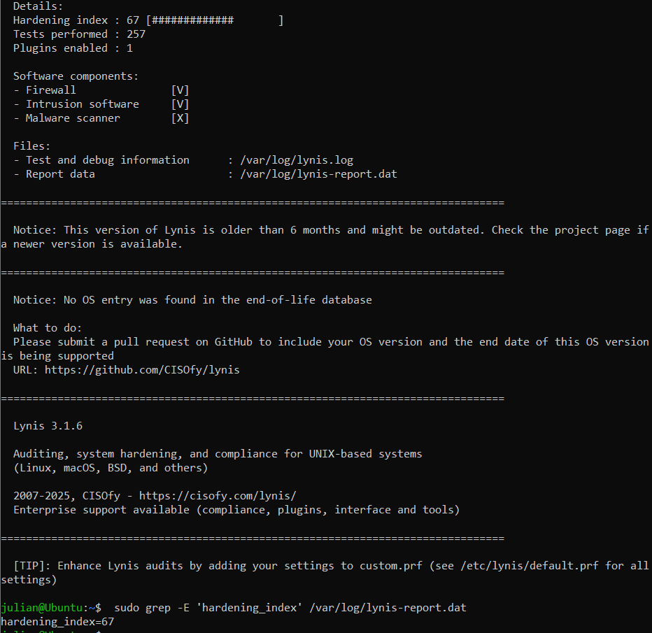
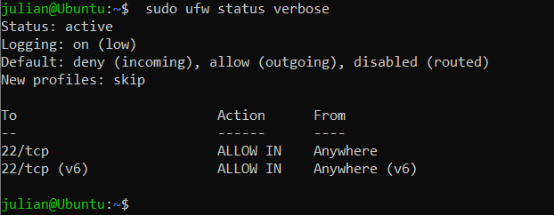
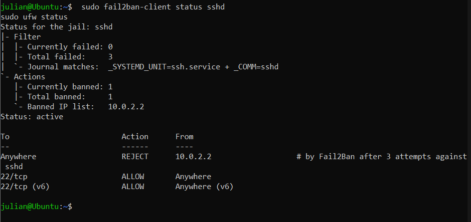

# Servidor Ubuntu endurecido en VirtualBox

Laboratorio práctico de hardening: una VM con Ubuntu Server (sin interfaz gráfica), acceso por SSH desde Windows y siete retos de seguridad, cada uno documentado con comandos, pruebas y decisiones.

> Es un entorno de laboratorio, no un servidor de producción. Donde una decisión sería distinta en producción, el documento lo dice.



## Resultados

| Área | Resultado |
|---|---|
| Acceso | Usuario normal con `sudo`; SSH solo con llaves ed25519 y sin login de `root` |
| Firewall | `ufw` con `deny incoming` / `allow outgoing`; único puerto abierto: 22 |
| Fuerza bruta | `fail2ban`: 3 fallos en 10 min → baneo de 10 min, probado con ataques reales de prueba |
| Parches | 65 paquetes pendientes → 5 (retenidos por *phasing*); actualizaciones de seguridad automáticas |
| Superficie de ataque | Un único puerto expuesto; servicios innecesarios revisados |
| Auditoría | Lynis 3.1.6: índice 67/100, 0 warnings (de 1), suggestions 45 → 41 |

## Evidencias

<p>
  
  
</p>

## Entorno

- **Anfitrión:** Windows (AMD)
- **Virtualización:** VirtualBox
- **Invitado:** Ubuntu Server LTS
- **Red:** NAT con reenvío de puertos (2222 del anfitrión → 22 de la VM)

## Retos

| Reto | Tema | Detalle |
|---|---|---|
| 0 | VM accesible por SSH desde Windows | [Ver](docs/reto-0-ssh.md) |
| 1 | Usuario normal con `sudo` | [Ver](docs/reto-1-usuarios.md) |
| 2 | SSH solo con llaves, sin login de root | [Ver](docs/reto-2-llaves-ssh.md) |
| 3 | Firewall con `ufw` | [Ver](docs/reto-3-ufw.md) |
| 4 | `fail2ban` contra fuerza bruta | [Ver](docs/reto-4-fail2ban.md) |
| 5 | Actualizaciones y servicios | [Ver](docs/reto-5-actualizaciones.md) |
| 6 | Auditoría con `lynis` | [Ver](docs/reto-6-lynis.md) |

Material de apoyo: [problemas encontrados](docs/problemas.md) · [comandos principales](docs/comandos.md) · [aprendizajes](docs/aprendizajes.md) · [configuraciones](configs/)

## Cómo trabajé

- Snapshot de la VM antes de cada reto.
- Una sesión SSH abierta como salvavidas y la consola de VirtualBox como segundo plan B.
- Validar antes de aplicar (`sshd -t`, `sshd -T`) y probar siempre desde una ventana nueva.
- Verificar cada resultado en lugar de darlo por hecho.

## Decisiones destacadas

- **Firewall por el puerto 22, no el 2222:** ufw vive dentro de la VM y solo ve el puerto del servicio, no el del reenvío de VirtualBox. [Explicación](docs/reto-3-ufw.md)
- **`ignoreip` vacío en fail2ban:** en NAT todo llega como `10.0.2.2`; ignorarla apagaría la protección. [Explicación](docs/reto-4-fail2ban.md)
- **Lynis: no perseguir la nota.** Se aplicaron 3 hallazgos y se descartaron otros con razones (por ejemplo, no instalar herramientas solo para subir el índice). [Análisis](docs/reto-6-lynis.md)

## Estructura

```
├── README.md
├── docs/          # un documento por reto + problemas, comandos y aprendizajes
├── configs/       # configuraciones resultantes (sshd, fail2ban, ufw)
└── evidencias/    # capturas de cada reto
```

## Tecnologías

VirtualBox · Ubuntu Server · OpenSSH · ufw · fail2ban · unattended-upgrades · Lynis
