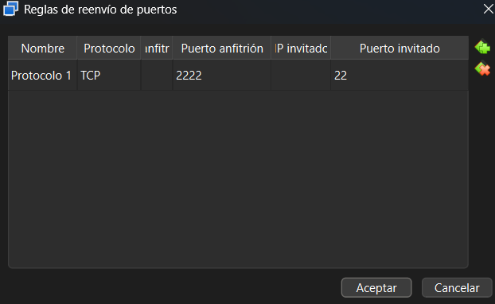

# Reto 0: VM accesible por SSH desde Windows




1. Instalar VirtualBox y crear la VM con Ubuntu Server.
2. Configurar la red en modo NAT.
3. Corregir la configuración de red de Ubuntu (ver [problemas encontrados](problemas.md)).
4. Instalar el servidor OpenSSH dentro de la VM.
5. Crear en VirtualBox la regla de reenvío: TCP, 127.0.0.1:2222 → puerto 22 de la VM.
6. Conectar desde CMD de Windows:

```
ssh -p 2222 vboxuser@127.0.0.1
```


---
[← Volver al índice](../README.md)
