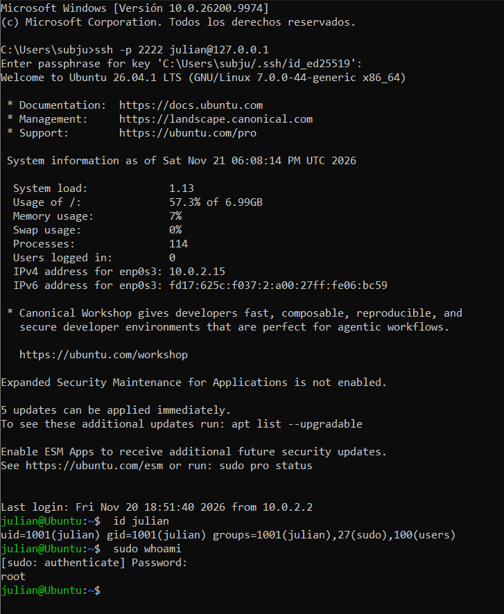

# Reto 1: usuario y acceso




Objetivo: dejar de depender del usuario genérico que crea el instalador y trabajar con un usuario normal que escala privilegios con `sudo` solo cuando hace falta.

1. **Contraseña propia para `vboxuser`:** se cambió con `passwd`. Se verificó cerrando sesión y comprobando que la contraseña anterior ya no entra.
2. **Usuario nuevo:** se creó con `sudo adduser julian`, que crea la carpeta personal, el grupo primario y pide la contraseña.
3. **Permisos de administrador:** se agregó al grupo `sudo` sin quitarle otros grupos:

```
sudo usermod -a -G sudo julian
```

4. **Prueba de acceso:** conexión por SSH con el usuario nuevo y verificación de permisos.

```
ssh -p 2222 julian@127.0.0.1
```

## Verificación

| Comando | Resultado | Qué demuestra |
|---|---|---|
| `id julian` | `uid=1001(julian) gid=1001(julian) groups=1001(julian),27(sudo),100(users)` | Existe, con grupo primario propio y pertenece a `sudo` |
| `sudo whoami` | `root` | `sudo` funciona con el usuario nuevo |
| `cat /etc/netplan/*.yaml` (sin `sudo`) | `Permission denied` | El archivo es de `root` con permisos `-rw-------` |
| `groupadd prueba` (sin `sudo`) | `Permission denied` y `cannot lock /etc/group` | Modificar grupos requiere privilegios |
| `sudo groupadd prueba` | Sin salida | Con `sudo` se crea el grupo |
| `getent group prueba` | `prueba:x:1002:` | El grupo existe (GID 1002) |
| `sudo groupdel prueba` | Sin salida | Grupo eliminado (limpieza del experimento) |

`vboxuser` no se eliminó: se conserva como acceso de respaldo hasta terminar el resto de los retos.


---
[← Volver al índice](../README.md)
