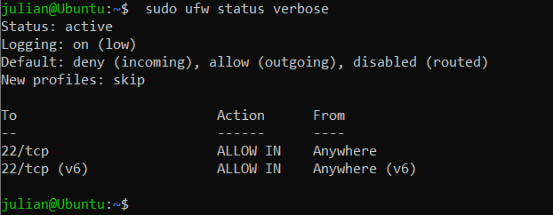

# Reto 3: firewall con ufw




Objetivo: activar un firewall que niegue todo el tráfico entrante salvo SSH, sin perder el acceso a la VM.

Precauciones: snapshot `Reto2-SSH-endurecido` tomado antes de empezar, una sesión SSH abierta como salvavidas y la consola de VirtualBox disponible.

## Tarea 1: estado inicial

```
sudo ufw status verbose
```

Resultado: `Status: inactive`. ufw viene instalado en Ubuntu pero apagado, y sin reglas activas.

## Tarea 2: políticas por defecto

```
sudo ufw default deny incoming
sudo ufw default allow outgoing
```

- **Entrante denegado:** cualquier servicio que quede escuchando por error en la VM no queda expuesto. Solo entra lo que se autorice con una regla explícita.
- **Saliente permitido:** es el tráfico que inicia la propia VM (`apt update`, DNS, parches de seguridad). Si se bloquea, la VM deja de actualizarse.
- Las respuestas a conexiones iniciadas por la VM sí entran, porque ufw es *stateful* (recuerda las conexiones).
- Estas políticas ya coinciden con los valores por defecto de ufw, pero se fijaron explícitamente para dejarlas documentadas.

## Tarea 3: permitir SSH antes de activar

Primero se confirmó el puerto real de SSH dentro de la VM:

```
sudo ss -tlnp | grep -E 'ssh|:22'
```

Resultado: `0.0.0.0:22` y `[::]:22`, es decir, SSH escucha en el **22** en IPv4 e IPv6.

```
sudo ufw allow 22/tcp
sudo ufw show added
```

`show added` listó `ufw allow 22/tcp` con el firewall todavía apagado.

**Por qué el 22 y no el 2222:** el firewall vive dentro de la VM y solo ve lo que llega a la VM. Mi PC se conecta al 2222, VirtualBox redirige esa conexión al 22 de la VM, y cuando el paquete llega a ufw ya trae como destino el 22. El 2222 es solo el puerto de mi PC en el reenvío de VirtualBox y el firewall nunca lo ve. Una regla para el 2222 no coincidiría con nada y SSH quedaría bloqueado.

**Por qué la regla va antes de activar:** con `deny incoming`, todo lo que no tenga regla se bloquea. Si el firewall se activa sin la regla del 22, se corta el acceso SSH.

## Tarea 4: activar y verificar

```
sudo ufw enable
sudo ufw status verbose
sudo ufw status numbered
```

ufw avisó: `Command may disrupt existing ssh connections`, y respondí `y`. Resultado:

```
Status: active
Logging: on (low)
Default: deny (incoming), allow (outgoing), disabled (routed)

To              Action      From
22/tcp          ALLOW IN    Anywhere
22/tcp (v6)     ALLOW IN    Anywhere (v6)
```

- Con `status numbered` cada regla tiene su propio número: `[1] 22/tcp` y `[2] 22/tcp (v6)`.
- `enabled on system startup`: el firewall queda encendido tras reiniciar.
- `disabled (routed)`: el reenvío está desactivado, no aplica porque la VM no actúa como router.

**IPv6:** en `/etc/default/ufw` el parámetro `IPV6=yes` hace que ufw aplique las reglas también a IPv6, y por eso cada regla se crea dos veces (v4 y `(v6)`). Con `no`, solo se aceptaría IPv6 en loopback. Si se cambia, hay que hacer `disable` y luego `enable`. En el mismo archivo se ven las políticas: `DEFAULT_INPUT_POLICY="DROP"` y `DEFAULT_OUTPUT_POLICY="ACCEPT"`.

## Tarea 5: prueba real

Desde una ventana nueva de Windows, con la sesión salvavidas abierta:

```
ssh -p 2222 julian@127.0.0.1
```

Pide la passphrase y entra. El firewall permite SSH y el reenvío de VirtualBox sigue funcionando.

## Reto extra: comprobar que el firewall bloquea

1. En VirtualBox se creó un reenvío temporal 127.0.0.1:8080 → 8080 de la VM.
2. En la VM, desde un directorio vacío: `mkdir ~/prueba && cd ~/prueba && python3 -m http.server 8080`. Con `ss -tlnp | grep 8080` se vio a `python3` escuchando en `0.0.0.0:8080`.
3. **Con el firewall bloqueando:** `http://127.0.0.1:8080` desde Windows se quedó cargando, sin respuesta. Con `deny` ufw descarta el paquete en silencio: no hay error inmediato, y quien escanea no sabe si el puerto existe.
4. **Permitiendo el puerto:** `sudo ufw allow 8080/tcp` (creó la regla v4 y v6). Al recargar, el navegador mostró `Directory listing for /` (vacío porque `~/prueba` estaba vacío).
5. **Evidencia en el log de Python:**

```
10.0.2.2 - - "GET / HTTP/1.1" 200 -
10.0.2.2 - - code 404, message File not found
10.0.2.2 - - "GET /favicon.ico HTTP/1.1" 404 -
```

La IP `10.0.2.2` es la dirección con la que VirtualBox (NAT) aparece ante la VM. El 404 de `favicon.ico` es normal: el navegador pide el icono de la pestaña y el servidor no lo tiene.

6. **Limpieza:** se detuvo el servidor con `Ctrl+C`, se borraron las reglas del 8080 con `sudo ufw delete allow 8080/tcp` y `status numbered` volvió a mostrar solo el 22 (v4 y v6). Se eliminó también el reenvío 8080 en VirtualBox.

Un servicio puede estar escuchando (`ss` lo muestra) y aun así ser inalcanzable desde fuera si el firewall no tiene una regla que lo permita.


---
[← Volver al índice](../README.md)
