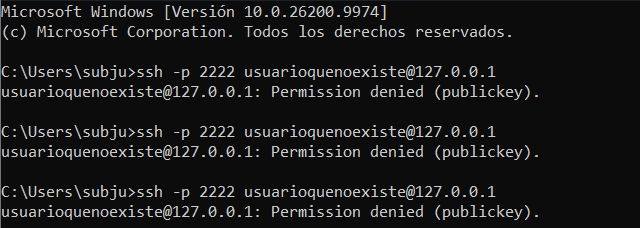
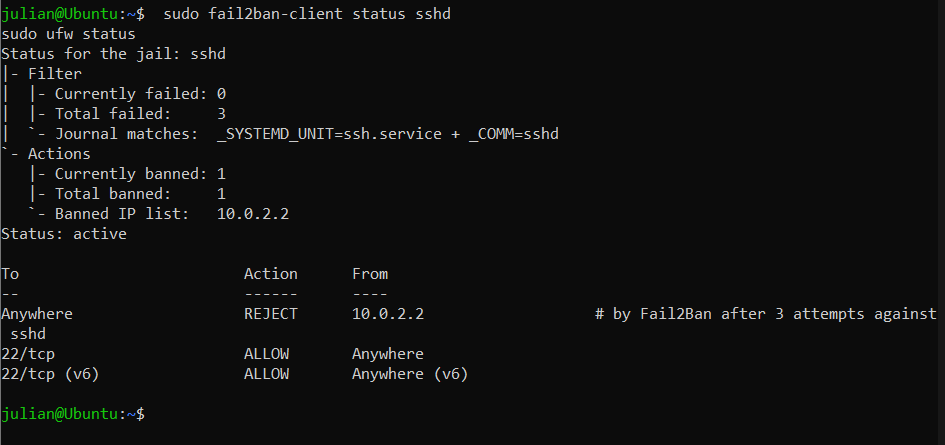

# Reto 4: fail2ban contra fuerza bruta






Objetivo: bloquear automáticamente las IP que fallan demasiadas veces al conectarse por SSH, usando ufw como mecanismo de bloqueo.

Precauciones: sesión SSH abierta como salvavidas (un baneo corta las conexiones nuevas, las abiertas suelen sobrevivir) y la consola de VirtualBox como segundo salvavidas.

## Tarea 1: instalar

```
sudo apt install fail2ban
systemctl status fail2ban
sudo fail2ban-client status
```

El servicio quedó activo y en Ubuntu el paquete trae el jail `sshd` activado por defecto.

## Tarea 2: valores por defecto

```
sudo fail2ban-client status sshd
sudo fail2ban-client get sshd maxretry   # 5
sudo fail2ban-client get sshd findtime   # 600
sudo fail2ban-client get sshd bantime    # 600
sudo fail2ban-client get sshd ignoreip   # vacío
```

- Regla por defecto: si alguien falla 5 veces en 10 minutos, se le bloquea 10 minutos.
- El filtro mostraba `Journal matches: _SYSTEMD_UNIT=ssh.service + _COMM=sshd`: el jail lee el diario de systemd, no un archivo. `/var/log/auth.log` también existe, pero el jail no lo usa.
- `jail.conf` no se edita: el paquete puede sobrescribirlo al actualizarse. Los cambios propios van en `jail.local`, que el paquete no toca.

## Tarea 3: configuración propia (`/etc/fail2ban/jail.local`)

```
[sshd]
enabled = true
maxretry = 3
findtime = 10m
bantime = 10m
ignoreip =
backend = systemd
banaction = ufw
```

| Parámetro | Valor | Por qué |
|---|---|---|
| `maxretry` | 3 | Fallos permitidos antes del baneo. Más estricto que el 5 por defecto |
| `findtime` | 10m | Ventana en la que se cuentan esos fallos |
| `bantime` | 10m | Duración del bloqueo. Durante las pruebas se usó `60` (60 s) y al terminar se subió a `10m` |
| `ignoreip` | vacío | Ninguna IP exenta, para poder probar el bloqueo (ver decisión abajo) |
| `backend` | systemd | Fija explícitamente la lectura del diario, en lugar de depender de la detección automática (`auto` solo prueba `pyinotify` y `polling`, que vigilan archivos) |
| `banaction` | ufw | Nombre de `/etc/fail2ban/action.d/ufw.conf` sin extensión. El baneo se hace con una regla de ufw |

Regla resultante: **si una IP falla 3 veces en 10 minutos, se le bloquea 10 minutos.**

Se aplicó con `sudo systemctl restart fail2ban` y se verificó con `get sshd maxretry`, `get sshd bantime` (responde en segundos: `10m` aparece como `600`) y `status sshd`.

## Tarea 4: prueba del baneo

Desde una ventana nueva de Windows, con la sesión salvavidas abierta, se provocaron fallos a propósito:

```
ssh -p 2222 usuarioquenoexiste@127.0.0.1
```

| Momento | `status sshd` |
|---|---|
| Antes | `Total failed: 0`, `Currently banned: 0` |
| Después | `Total failed: 4`, `Currently banned: 1`, `Banned IP list: 10.0.2.2` |

En `sudo ufw status` apareció una regla nueva **por encima** de `22/tcp ALLOW`:

```
Anywhere    REJECT    10.0.2.2    # by Fail2Ban after 3 attempts against sshd
```

El comentario confirma que se aplicó `maxretry = 3`. Como en ufw gana la primera regla que coincide, el baneo manda sobre la regla que permite SSH.

**Mi usuario real también quedó bloqueado:** tras insistir, la conexión con `julian` ya no entraba ni cargaba. Fail2ban banea por IP, no por usuario, y en NAT todas las conexiones llegan como `10.0.2.2`.

**Desbloqueo:** desde la sesión salvavidas se ejecutó `sudo fail2ban-client set sshd unbanip 10.0.2.2`, que respondió `0`: el baneo (60 s en la prueba) ya había vencido, así que no había nada que quitar. El baneo expiró solo.

## Decisión sobre `ignoreip`

Se dejó **vacía**. Con la 10.0.2.2 en la lista, fail2ban nunca bloquearía esa IP, pero tampoco contaría ningún fallo que llegue por ella. En este entorno todo el acceso llega como 10.0.2.2, así que esa exención desactivaría la protección del jail. El costo de no ignorarla es que, si fallo tres veces seguidas, me bloqueo yo mismo durante 10 minutos; para eso están la sesión salvavidas y la consola de VirtualBox.

Esto es una decisión de laboratorio. En un servidor real con acceso directo desde internet, la IP de administración sí suele ir en `ignoreip`, pero una dirección fija y propia, no la de un NAT compartido.


---
[← Volver al índice](../README.md)
