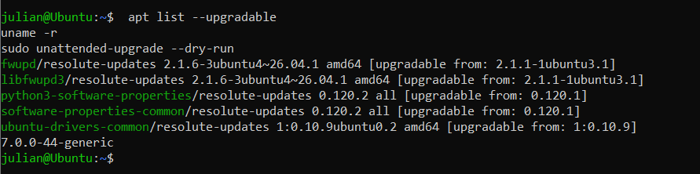

# Reto 5: actualizaciones y servicios




Objetivo: mantener el sistema parcheado, automatizar las actualizaciones de seguridad y reducir la superficie de ataque revisando puertos y servicios.

Precauciones: snapshot previo y sesión SSH abierta, porque una actualización puede reiniciar servicios o exigir reinicio por un kernel nuevo.

## Tarea 1: qué había pendiente

```
sudo apt update
apt list --upgradable
```

- `apt update` descarga la lista de paquetes y versiones; no instala nada. `apt upgrade` instala las versiones nuevas de lo que ya está instalado. Sin `update` previo, `upgrade` trabaja con una lista vieja.
- El banner de inicio decía 45 pendientes (lista vieja). Tras `apt update` salieron **65**. Entre ellos, paquetes del kernel (`linux-image`) y de Python.

## Tarea 2: aplicar las actualizaciones

```
sudo apt upgrade
```

- Resultado: **65 → 5 pendientes**. Los 5 restantes (`fwupd`, `libfwupd3`, `python3-software-properties`, `software-properties-common`, `ubuntu-drivers-common`) no se instalan por *phasing*: Ubuntu libera ciertas actualizaciones por etapas a un porcentaje de máquinas. El resumen decía `Upgrading: 0, Not Upgrading: 5`. No se fuerzan: se instalarán solos cuando les toque.
- El `6` de `apt list --upgradable | wc -l` incluye la línea de encabezado `Listing...`; los paquetes reales son 5.
- **Reinicio:** un kernel nuevo exige reiniciar porque el kernel viejo sigue cargado en memoria hasta entonces; el paquete nuevo en disco no protege hasta que se carga. Antes de reiniciar se comprobó con `systemctl is-enabled ssh.socket ufw fail2ban` que los tres están `enabled`. Tras `sudo reboot` se entró de nuevo por SSH y el kernel pasó a `7.0.0-44-generic` (`uname -r`).
- Después del reinicio, `ls /var/run/reboot-required` responde `No such file or directory`: ya no hay reinicio pendiente.
- **`autoremove`:** `apt` avisó de paquetes `linux-*-7.0.0-30` ya innecesarios (el kernel anterior). Como `uname -r` mostraba `7.0.0-44`, era seguro ejecutar `sudo apt autoremove`, y se eliminaron solo paquetes de la versión `-30`. Antes de borrar hay que confirmar que no se está corriendo ese kernel.
- Espacio en disco tras las actualizaciones: `/dev/sda2` 7,0 G, 4,0 G usados (60 %). El banner de días antes mostraba 56,4 % de 6,99 GB (lectura previa a actualizar, no comparable exactamente).

## Tarea 3: actualizaciones automáticas (`unattended-upgrades`)

```
dpkg -l | grep unattended
cat /etc/apt/apt.conf.d/20auto-upgrades
grep -v '^//' /etc/apt/apt.conf.d/50unattended-upgrades | grep -v '^$'
sudo unattended-upgrade --dry-run
```

- Está instalado (`ii unattended-upgrades 2.12ubuntu9`) y activado por defecto: en `20auto-upgrades`, `Update-Package-Lists "1"` y `Unattended-Upgrade "1"` (con `"0"` estarían apagadas).
- **`Allowed-Origins` activos:** la base de la versión, `-security`, y los orígenes ESM (`ESMApps` y `ESM`, que solo aplican con Ubuntu Pro; el banner indicaba que no está habilitado). **No incluye `-updates`**: solo instala solo las correcciones de seguridad, y el resto lo aplico yo con `apt upgrade`. Es una decisión prudente en un servidor, porque las demás actualizaciones pueden cambiar comportamiento.
- `Package-Blacklist` vacío: no se excluye ningún paquete.
- **`--dry-run`:** `No packages found that can be upgraded unattended and no pending auto-removals`. El mensaje `The list of kept packages can't be calculated in dry-run mode` es normal en simulación.
- Registro: `/var/log/unattended-upgrades/unattended-upgrades.log` muestra ejecuciones del 17 y 19 de noviembre, así que ya corre solo. El directorio pertenece a `root` (`ls` sin `sudo` da `Permission denied`).
- Las ejecuciones las lanzan temporizadores de systemd (`apt-daily` y `apt-daily-upgrade`, con retraso aleatorio); no hay una hora fija de actualización.

**`Automatic-Reboot`:** viene comentado y con valor por defecto `false` (junto con `Automatic-Reboot-WithUsers "true"` y `Automatic-Reboot-Time "02:00"`, que son valores de ejemplo y solo actuarían si se descomentan y se activa `Automatic-Reboot`). Con `false`, el sistema instala las correcciones, kernel incluido, pero no reinicia solo, y el kernel nuevo no protege hasta que se reinicie a mano.

- **Decisión en el laboratorio:** dejarlo en `false` y reiniciar manualmente cuando exista `/var/run/reboot-required`, en un momento elegido por mí.
- **En un servidor real:** activarlo con una hora de baja actividad suele ser razonable, porque un servidor que nunca se reinicia acumula kernels sin aplicar. El riesgo es un reinicio sin aviso que corte servicios o deje algo mal sin que nadie lo vea; por eso se acompaña de monitorización y, con varios servidores, de reinicios escalonados.

## Tarea 4: puertos y servicios

```
sudo ss -tulpn
systemctl list-units --type=service --state=running
```

**Puertos en escucha:**

| Puerto | Escucha en | Proceso | Justificación |
|---|---|---|---|
| TCP 22 | `0.0.0.0` y `[::]` | `sshd` (y `systemd`, activación por socket) | Acceso por SSH. Es lo único permitido por ufw |
| TCP/UDP 53 | `127.0.0.53` y `127.0.0.54` | `systemd-resolved` | DNS local de la VM |
| UDP 68 | `10.0.2.15` (enp0s3) | `systemd-networkd` | Cliente DHCP: así obtiene su IP |
| UDP 323 | `127.0.0.1` y `[::1]` | `chronyd` | Sincronización de hora |

Solo el 22 escucha en todas las interfaces, y es el que permite ufw. El resto está ligado a `127.0.0.x` o `::1` (accesible solo desde dentro de la VM), así que no hay servicios escuchando que el firewall esté bloqueando. **Superficie externa: un único puerto, el 22.**

**Servicios en ejecución (justificados):**

| Servicio | Para qué sirve |
|---|---|
| `ssh.service` | Acceso por SSH |
| `fail2ban.service` | Protección contra fuerza bruta (Reto 4) |
| `systemd-networkd`, `systemd-resolved`, `networkd-dispatcher` | Red y DNS |
| `systemd-logind`, `user@1001`, `dbus`, `polkit` | Sesiones, usuario y permisos |
| `systemd-journald`, `rsyslog` | Registros (fail2ban lee el diario) |
| `systemd-udevd` | Detección de dispositivos |
| `chrony` | Hora sincronizada, necesaria para logs y tiempos de baneo coherentes |
| `cron` | Tareas programadas |
| `unattended-upgrades` | Actualizaciones automáticas de seguridad |
| `getty@tty1` | Consola de VirtualBox (segundo salvavidas) |

**Servicios revisados por no ser evidentes:** `ModemManager`, `multipathd`, `udisks2` y `snapd`.

- **`ModemManager` (desactivado):** gestiona módems móviles (3G/4G); la VM no tiene ese hardware ni abre puertos. `systemctl list-dependencies --reverse ModemManager` solo mostró `multi-user.target` y `graphical.target`, que son los *targets* que lo arrancan, no servicios que lo necesiten. Se aplicó `sudo systemctl disable --now ModemManager`: `status` muestra `disabled` y `inactive (dead)`, y `ss -tulpn` quedó igual que antes (no abría puertos). Se revierte con `sudo systemctl enable --now ModemManager`.
- **`multipathd`, `udisks2` y `snapd` (se dejaron activos):** no se revisaron en detalle sus dependencias ni hubo un motivo claro para quitarlos. `snapd` es el más delicado, porque otros componentes de Ubuntu pueden depender de él.

`disable` evita que arranque en el próximo inicio, mientras que `stop` solo lo apaga hasta el próximo reinicio; `disable --now` hace las dos cosas.


---
[← Volver al índice](../README.md)
