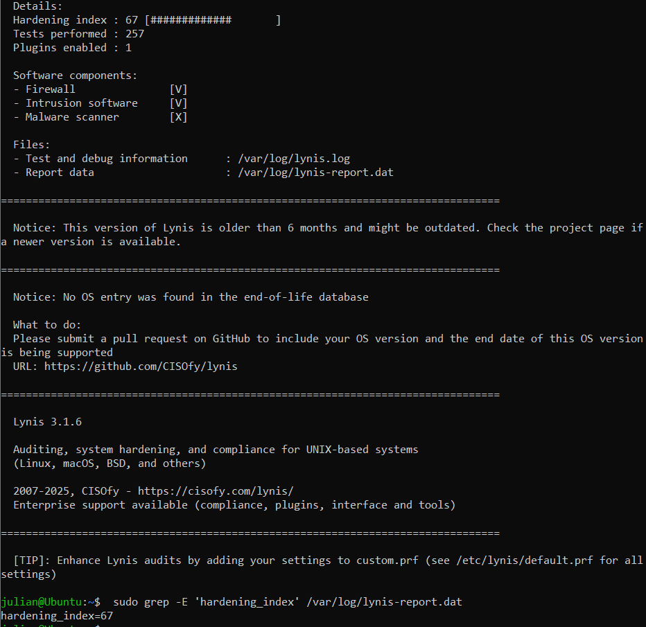
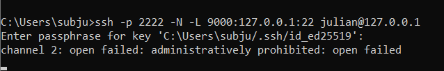

# Reto 6: auditoría con lynis




Objetivo: medir con una herramienta de auditoría lo hecho en los retos anteriores, entender cada hallazgo y decidir cuáles aplicar. El número no es la meta: la meta es entender y justificar cada decisión.

Precauciones: snapshot previo (`Reto5-actualizaciones`), sesión SSH abierta como salvavidas y protocolo del Reto 2 para cualquier cambio en SSH (respaldo, `sshd -t`, `sshd -T`, reinicio y prueba desde una ventana nueva). Snapshot final: `Reto6-lynis`.

## Tarea 1: instalar

```
sudo apt install lynis
lynis --version
```

Versión instalada: **Lynis 3.1.6**. Lynis compara el sistema contra un perfil genérico de servidor y marca lo que difiere; no revisa "todo", y muchas sugerencias son opinables.

## Tarea 2: auditorías y comparación

```
sudo lynis audit system
```

Los resultados quedan en `/var/log/lynis.log` y `/var/log/lynis-report.dat`. Para contar o listar los hallazgos:

```
sudo grep -c '^warning\[\]' /var/log/lynis-report.dat
sudo grep -c '^suggestion\[\]' /var/log/lynis-report.dat
sudo grep -E 'PKGS-7346|SSH-7408' /var/log/lynis-report.dat
```

| Dato | Primera auditoría | Segunda auditoría |
|---|---|---|
| Hardening index | no se anotó | **67** de 100 |
| Pruebas realizadas | no se anotó | 257 |
| Warnings | 1 (`PKGS-7392`) | **0** |
| Suggestions | 45 | **41** |

- La primera auditoría no tiene anotados el índice ni el número de pruebas, así que la comparación de índice no es posible. Lo que sí se puede comparar son los warnings y las suggestions.
- Bajaron 4 suggestions. Tres se explican por lo aplicado (`MaxAuthTries`, `AllowTcpForwarding` y la purga de `PKGS-7346`); la cuarta no se identificó.
- Avisos informativos del final, que no indican un problema del sistema: `Malware scanner [X]` (no hay escáner de malware instalado), "esta versión de Lynis tiene más de 6 meses" y "no hay entrada del SO en la base de datos de fin de vida" (la versión de Ubuntu es más reciente que esa base).
- Lynis reconoció el trabajo previo: no apareció ninguna sugerencia sobre firewall, fail2ban, `PasswordAuthentication` ni `PermitRootLogin`.

## Warning `PKGS-7392` (paquetes vulnerables)

```
sudo lynis show details PKGS-7392
apt list --upgradable
```

- En la segunda corrida, el detalle dice `no vulnerable packages found` (con `apt-check` y en el resultado final): ya no hay paquetes con actualizaciones de seguridad pendientes, y por eso el warning desapareció.
- Los 5 paquetes que siguen pendientes (`fwupd`, `libfwupd3`, `python3-software-properties`, `software-properties-common`, `ubuntu-drivers-common`) vienen de `resolute-updates`, no de `-security`. Son actualizaciones normales, probablemente retenidas por *phasing* (la salida no lo confirma), y se instalarán solas.

## Tarea 3: tres hallazgos analizados

Detalle de cualquier hallazgo: `sudo lynis show details CÓDIGO`.

| Hallazgo | Riesgo que cubre | ¿Aplica al laboratorio? | ¿Puede romper algo? | Decisión |
|---|---|---|---|---|
| `SSH-7408` `MaxAuthTries` (6 → 3) | Limita los intentos fallidos dentro de una misma conexión | Sí, como defensa en profundidad con efecto pequeño | Solo si hubiera varias llaves cargadas: cada llave rechazada gasta un intento. Hay una sola (`id_ed25519`) | **Aplicada** |
| `SSH-7408` `AllowTcpForwarding` (YES → NO) | Impide usar la sesión SSH como túnel hacia puertos internos o como punto de paso (`-L`, `-R`, `-D`) | Sí | No rompe el reenvío 2222 → 22 de VirtualBox, porque ese ocurre en la red NAT, fuera de SSH. Sí dejaría de funcionar un salto con `ssh -J` | **Aplicada** |
| `PKGS-7346` paquetes viejos | Restos de configuración (estado `rc`) de paquetes ya removidos | Sí, es de bajo riesgo | No, tras leer la lista que muestra `apt` | **Aplicada** (purga) |

**`MaxAuthTries` y fail2ban se complementan.** `MaxAuthTries` corta cada conexión tras pocos fallos, pero un atacante abre otra y sigue: quien lo frena es fail2ban, que cuenta los fallos entre conexiones y bloquea la IP. Además, con `PasswordAuthentication no` no se pueden adivinar contraseñas, solo probar llaves. La passphrase se verifica en el PC al abrir la llave privada, así que equivocarse ahí no llega al servidor y no cuenta como intento.

**`AllowTcpForwarding no` es defensa en profundidad, no una garantía.** El manual de `sshd_config` avisa de que un usuario con acceso a una shell puede instalar sus propios reenviadores y esquivar el bloqueo.

**Prueba del túnel** (dos ventanas de Windows, antes y después del cambio):

```
# Ventana A: abre el túnel (puerto 9000 de Windows → puerto 22 de la VM)
ssh -p 2222 -N -L 9000:127.0.0.1:22 julian@127.0.0.1
# Ventana B: usa el túnel
ssh -p 9000 julian@127.0.0.1
```

Resultado observado con `AllowTcpForwarding no`:

| Ventana | Resultado |
|---|---|
| A (túnel) | `channel 2: open failed: administratively prohibited: open failed` |
| B (uso del túnel) | `kex_exchange_identification: read: Connection aborted` |



El túnel se abre, pero cada conexión que intenta pasar por él es rechazada por el servidor. Con `yes`, la ventana B habría pedido la passphrase y entrado a la VM.

**Paquetes `rc` purgados:** `linux-image-7.0.0-30-generic`, `linux-modules-7.0.0-30-generic` y `linux-main-modules-zfs-7.0.0-30-generic`, restos del kernel anterior que `autoremove` quitó en el Reto 5 (dejó su configuración en estado `rc`). Tras la purga, `dpkg -l | grep '^rc'` ya no imprime nada. `remove` quita el programa y deja su configuración; `purge` quita también la configuración.

**Hallazgos revisados y no aplicados:**

- `SSH-7408` `Port` (cambiar el 22): no se aplica. Rompería el reenvío 2222 → 22 de VirtualBox y la regla de ufw.
- `FILE-6310` (particiones separadas): se decide al instalar el sistema, no después.
- `BOOT-5122` (contraseña de GRUB): no aporta en un laboratorio con un único usuario, donde la consola de VirtualBox y los snapshots son el plan B.
- Herramientas que añaden software (`auditd`, `debsums`, escáner de malware): no se instalaron solo para subir la nota, porque aumentan la superficie de ataque.

## Verificación tras los cambios

```
sudo sshd -T | grep -Ei 'maxauthtries|allowtcpforwarding'
```

Resultado: `maxauthtries 3` y `allowtcpforwarding no`. El acceso con `ssh -p 2222 julian@127.0.0.1` desde una ventana nueva se probó con la sesión salvavidas abierta.

Con 67 de índice, 0 warnings y 41 suggestions quedan sugerencias sin aplicar: es esperable, porque cada una pesa poco y muchas no convienen en una VM de laboratorio.


---
[← Volver al índice](../README.md)
